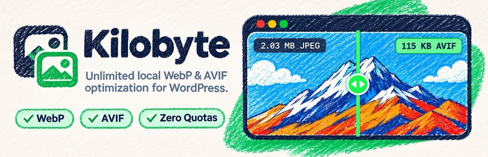

# Kilobyte Image Optimizer

Unlimited free image optimization for WordPress — compress, resize, and convert photos to **WebP** and **AVIF** in your browser or on your WordPress site, with no account, no API key, and no monthly credit limits.

## Design Philosophy

We care about your experience because we are WordPress users too. Kilobyte is designed to feel like a natural part of WordPress:

- **Ready right after activation:** Works without an account, API key, or monthly quota. Processing runs in your browser or with your WordPress site's built-in image editor.
- **Calm admin experience:** Keeps your dashboard focused on your media, with clean controls and no promotional banners or locked settings.
- **Native WordPress interface:** Built with `@wordpress/components` organized into four simple tabs (**Preview**, **Selective optimize**, **Bulk optimize**, **Preference**).
- **Safe by default:** Leaves your original Media Library files and existing image URLs untouched, so you can test freely and restore anytime.

## Key Features

- **Automatic image compression on upload:** Creates smaller copies of supported images right after WordPress saves the original — using your browser for Gutenberg and Media Library uploads, or WordPress scheduled tasks for classic, mobile app, and server-handled REST uploads.
- **Live quality preview & single optimize:** Compare compression side by side on any photo from your Media Library or computer, switch formats and presets live, and save a single image with **Optimize now** (or **Download copy** for local files).
- **Selective optimize:** Multi-select specific Media Library photos (paginated for large selections) to optimize a single post, landing page, or gallery without running a full bulk job.
- **Bulk image optimizer:** Optimize your entire Media Library with resumable pagination, live ETA, reload protection, and one-click retry for failed items.
- **WebP & AVIF converter + static GIF support:** Converts JPEG, PNG, BMP, and static GIF images to WebP or AVIF while automatically detecting and leaving animated GIFs, APNGs, and animated WebPs untouched.
- **Non-destructive originals & 1-click restore:** Keeps original Media Library files in place, serves smaller copies via `<picture>` with automatic fallback, and lets you restore a single image or **Restore all**.
- **Resize optimized copies, regenerate thumbnails & optional hints:** Scale down oversized copies, rebuild registered WordPress thumbnail sizes safely, fill empty alt text from filenames, and add image decoding hints.
- **WP-CLI & developer hooks:**
  - `wp kilobyte optimize`, `wp kilobyte restore`, `wp kilobyte stats`, `wp kilobyte purge-backups`
  - `kilobyte_io_variant_filename` — filter generated variant filenames
  - `kilobyte_io_variant_changed` — action fired on create/restore for page-cache invalidation

## Requirements

- WordPress **6.6** or later (tested up to **7.1**)
- PHP **7.4** or later
- Node.js **24.15+** (for building frontend assets from source)

## Installation

1. Upload the `kilobyte-image-optimizer` folder to `/wp-content/plugins/` (or install the release ZIP via **Plugins → Add New → Upload Plugin**).
2. Activate **Kilobyte Image Optimizer**.
3. Open **Media → Optimization**, test any photo in **Preview**, optimize chosen files in **Selective optimize**, or run **Bulk optimize**.

## Development & Contributing

See [CONTRIBUTING.md](CONTRIBUTING.md) for architecture notes, coding standards, local setup, and pull request guidelines.

```bash
# Install dev dependencies
composer install
npm ci

# Watch and rebuild frontend assets
npm run start

# Auto-fix PHP formatting (WordPress-VIP-Go + WordPress-Extra)
npm run lint:php:fix

# Run PHPCS (uncached), TypeScript check, production build, and headless Plugin Check
npm run verify

# Build a clean WordPress.org release ZIP in dist/
npm run package
```

## License

Licensed under the [GNU General Public License v2.0 or later](LICENSE) (`GPL-2.0-or-later`).
