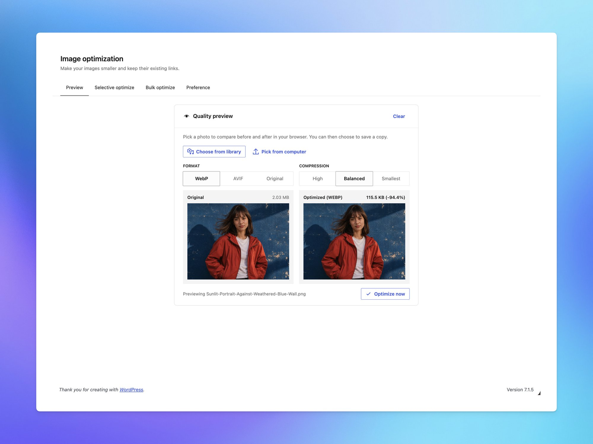
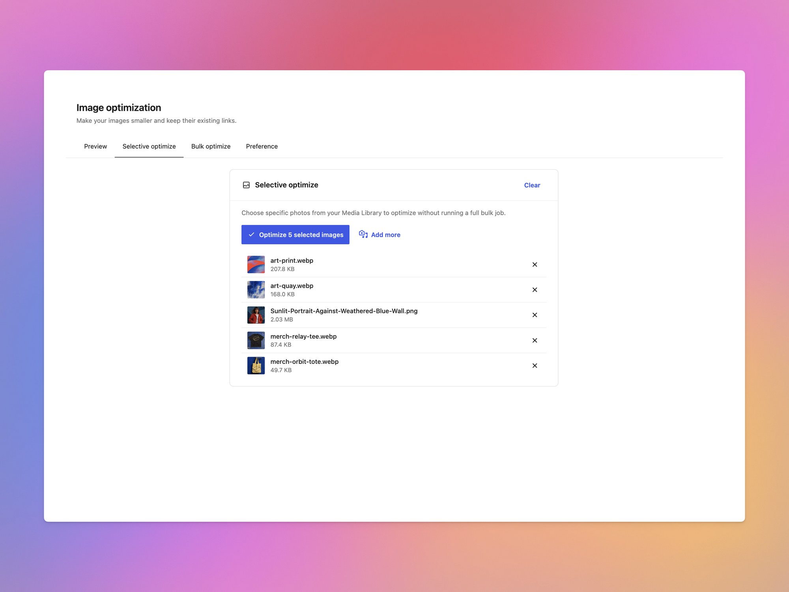
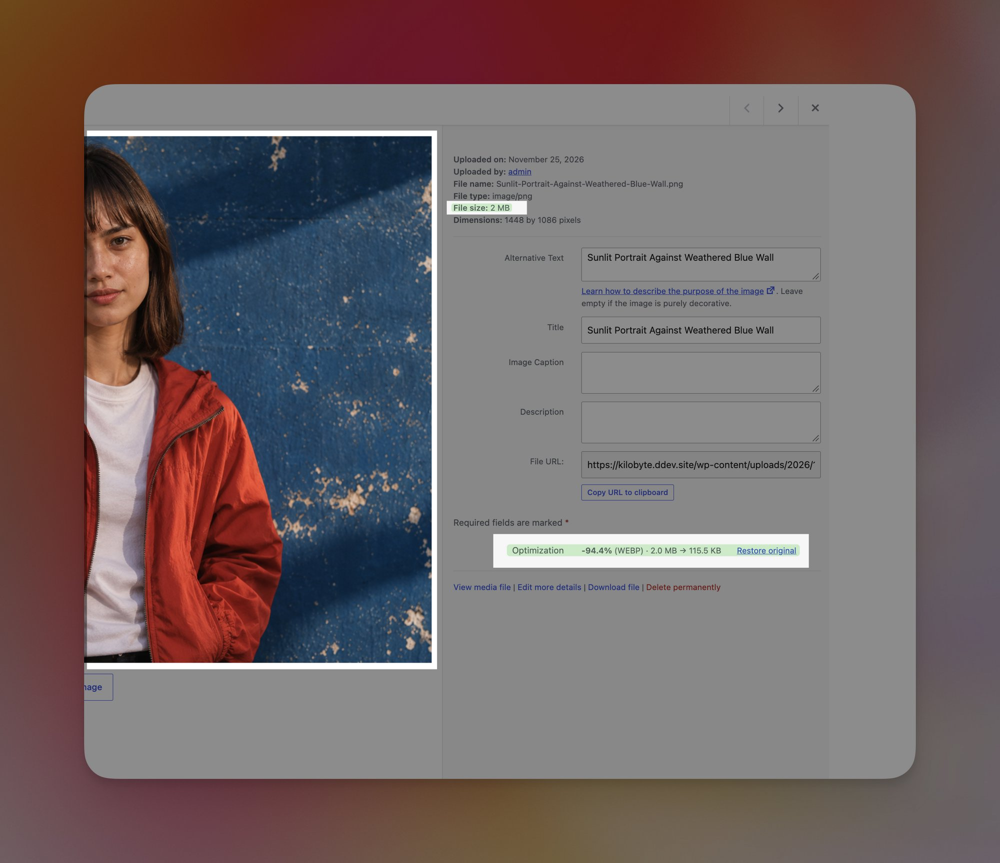
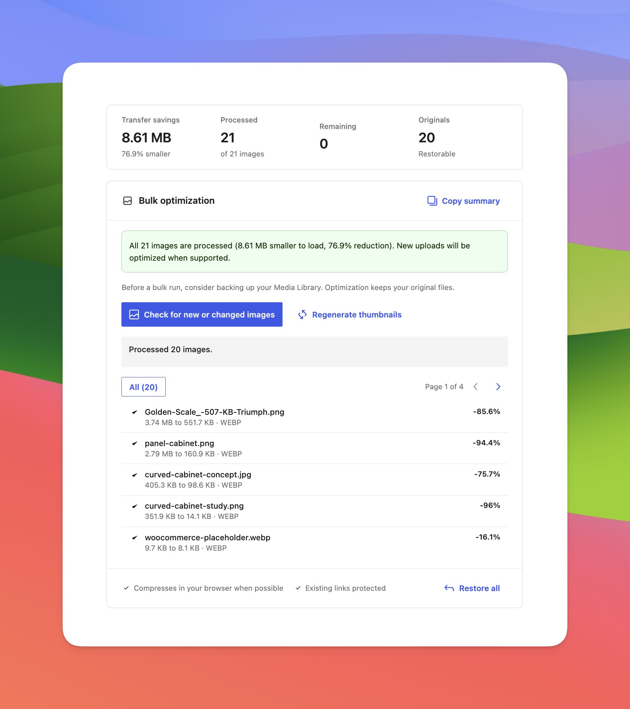
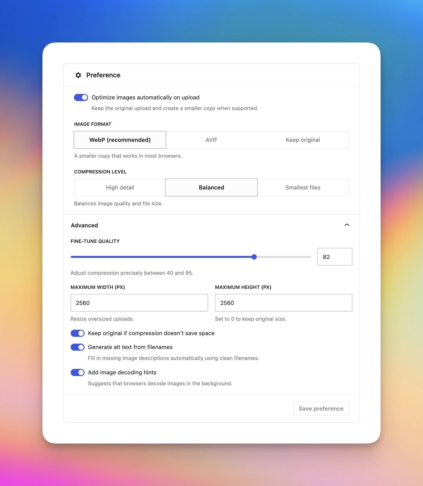

# Kilobyte Image Optimizer

[](https://github.com/JosephGabito/kilobyte-image-optimizer/actions/workflows/ci.yml)
[](https://wordpress.org/plugins/kilobyte-image-optimizer/)
[](https://playground.wordpress.net/?blueprint-url=https://raw.githubusercontent.com/JosephGabito/kilobyte-image-optimizer/main/.wordpress-org/blueprints/blueprint.json)
[](https://wordpress.org/plugins/kilobyte-image-optimizer/)
[](https://wordpress.org/plugins/kilobyte-image-optimizer/)
[](https://wordpress.org/plugins/kilobyte-image-optimizer/)
[](https://github.com/JosephGabito/kilobyte-image-optimizer/actions/workflows/ci.yml)
[](LICENSE)

Unlimited free image optimization for WordPress — compress, resize, and convert photos to **WebP** and **AVIF** in your browser or on your WordPress site, with no account, no API key, and no monthly credit limits.

## Our Philosophy

We care about your experience because we are WordPress users too. Kilobyte is designed to feel like a natural part of WordPress:

- **Ready right after activation:** Works right out of the box with no account, API key, or monthly quota. Processing runs in your browser or with your WordPress site's built-in image editor.
- **Calm admin experience:** Keeps your WordPress dashboard clean and focused on your media, with simple controls and every included setting ready to use.
- **Native WordPress interface:** Built with `@wordpress/components` organized into four simple tabs (**Preview**, **Selective optimize**, **Bulk optimize**, **Preference**).
- **Safe by default:** Leaves your original Media Library files and existing image URLs untouched, so you can test freely and restore anytime.

## Screenshots

<p align="center">
  
  <br />
  <sub><strong>Quality preview</strong> · Compare WebP, AVIF, or original output side by side in your browser before saving.</sub>
</p>

<table>
  <tr>
    <td width="50%" valign="top">
      
      <br />
      <sub><strong>Selective optimize</strong> · Pick specific Media Library photos without running a full bulk job.</sub>
    </td>
    <td width="50%" valign="top">
      
      <br />
      <sub><strong>Media Library integration</strong> · Keeps your original file intact with savings and one-click restore right in the modal.</sub>
    </td>
  </tr>
  <tr>
    <td width="50%" valign="top">
      
      <br />
      <sub><strong>Bulk optimization</strong> · Track transfer savings, copy a summary, regenerate thumbnails, or restore all in one click.</sub>
    </td>
    <td width="50%" valign="top">
      
      <br />
      <sub><strong>Preference &amp; fine-tuning</strong> · Native WordPress controls for format, compression, resize limits, auto alt text, and decoding hints.</sub>
    </td>
  </tr>
</table>

## Key Features

- **Unlimited free image optimization:** Optimize your entire Media Library with no account, API key, monthly quota, or thumbnail credit cap.
- **Automatic image compression on upload:** Creates smaller copies of supported images right after WordPress saves the original — using your browser for Gutenberg and Media Library uploads, or WordPress scheduled background tasks for classic, mobile app, and server-handled REST uploads.
- **Live quality preview & single optimize:** Compare compression side by side on any photo from your Media Library or computer, switch formats (WebP, AVIF, Original) and compression presets (High detail, Balanced, Smallest files) live, and save immediately with **Optimize now** (or **Download copy** for local files).
- **Selective optimize:** Multi-select specific Media Library photos (paginated for large selections) to optimize a single post, landing page, or gallery without running a full bulk job.
- **Bulk image optimizer:** Process your entire Media Library with resumable pagination, live ETA, reload protection, per-reason skip totals, links to unavailable Media Library entries, and one-click retry for failed items.
- **WebP & AVIF converter + static GIF support:** Converts JPEG, PNG, BMP, and static GIF images to WebP or AVIF while automatically detecting and preserving animated GIFs, APNGs, and animated WebPs.
- **Browser Web Worker + automatic server fallback:** Runs compression off the main thread in your browser without requiring `exec()`, and falls back automatically to WordPress's built-in image editor (Imagick or GD) when needed.
- **Non-destructive originals & 1-click restore:** Keeps original Media Library files and existing URLs in place, serves smaller copies via `<picture>` with automatic fallback, and lets you restore a single image from the Media Library (list view or media modal) or choose **Restore all**.
- **Cache-safe 24-hour deferred cleanup:** Keeps retired copies available for at least 24 hours so cached pages never break, then cleans up eligible copies in bounded background batches while preserving recovery state across reinstalls.
- **Resize optimized copies:** Scale down oversized copies to your maximum width and height while leaving the uploaded original untouched.
- **Regenerate thumbnails:** Rebuild registered WordPress thumbnail sizes without breaking existing thumbnail or original URLs.
- **Copyable optimization summary:** Copy a plain-text summary of optimized counts, estimated transfer savings, and active format in one click.
- **Optional auto alt text & image decoding hints:** Fill empty alt text cleanly from attachment filenames on upload and add browser image decoding hints.
- **Per-attachment permissions & multisite awareness:** Enforces WordPress `edit_post` permissions across REST routes and Media Library controls and scopes network lifecycle operations per site.
- **WP-CLI & developer hooks:**
  - `wp kilobyte optimize`, `wp kilobyte restore`, `wp kilobyte stats` (`--reconcile`), `wp kilobyte purge-backups`
  - `kilobyte_io_settings` — filter active plugin preferences
  - `kilobyte_io_should_optimize` / `kilobyte_io_after_optimize` — control and react to optimization
  - `kilobyte_io_variant_filename` — customize generated variant filenames
  - `kilobyte_io_variant_changed` — action fired on create/restore for page-cache invalidation

## Requirements

- WordPress **6.6** or later (tested up to **7.1**)
- PHP **7.4** or later
- Node.js **24.15+** (for building frontend assets from source)

## Installation

1. Upload the `kilobyte-image-optimizer` folder to `/wp-content/plugins/` (or install the release ZIP via **Plugins → Add New → Upload Plugin**).
2. Activate **Kilobyte Image Optimizer**.
3. Open **Media → Optimization**, test any photo in **Preview**, optimize chosen files in **Selective optimize**, or run **Bulk optimize**.

## Development & Contributing

See [CONTRIBUTING.md](CONTRIBUTING.md) for architecture notes, coding standards, local setup, and pull request guidelines.

```bash
# Install dev dependencies
composer install
npm ci

# Watch and rebuild frontend assets
npm run start

# Auto-fix PHP formatting (WordPress-VIP-Go + WordPress-Extra)
npm run lint:php:fix

# Run the PHPUnit integration tests (see tests/README.md for the test database setup)
composer test
composer test:coverage

# Run PHPCS (uncached), TypeScript check, production build, and headless Plugin Check
npm run verify

# Build a clean WordPress.org release ZIP in dist/
npm run package
```

## License

Licensed under the [GNU General Public License v2.0 or later](LICENSE) (`GPL-2.0-or-later`).
